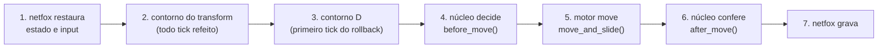

# Rede

Estado atual: o Desenho 3 (TASK-5) fechado, com as DEC-0023 a DEC-0026, a DEC-0037 e a DEC-0038. A parte 1 do esqueleto andante (TASK-9) pôs o lutador no tick do netfox, no modo Sozinho, com a SyncTest no portão. A parte 2 pôs a rede de verdade: o servidor dedicado e os clientes da `Main` (§9), e a corrida de 30 s a ping 100 sem nenhum tick corrigido (§10).

- A parte 3 do esqueleto andante levou o servidor para a build e para o contêiner do CI, testado em todo push da main e em todo PR (TASK-9; DEC-0032 §1; §10).
- A TASK-10.1 trouxe o pulo duplo e a stamina, e a SyncTest passou a comparar o estado inteiro (§4).
- A compensação e a detecção do golpe nascem com a espada: local na fase 2, em rede na fase 3 (F-023 §3).
- A versão visual e interativa deste documento é a vitrine [A rede por dentro](https://claude.ai/artifact/Sb4Q5e4M16UymdoaR9UAzp), privada (DEC-0019), na versão 9.

**Como o netfox é citado aqui:**

- **O código** está em `addons/`, no commit `cf5189d` (DEC-0023). Cada citação traz o arquivo e, quando ajuda, a função.
- **Os guias** não foram copiados e são citados pelo GitHub, no mesmo commit:
  - [`rollback-caveats.md`](https://github.com/foxssake/netfox/blob/cf5189d18e98766022c8c1c5e637a6a30c4c3703/docs/netfox/tutorials/rollback-caveats.md)
  - [`input-gathering-tips-and-tricks.md`](https://github.com/foxssake/netfox/blob/cf5189d18e98766022c8c1c5e637a6a30c4c3703/docs/netfox/tutorials/input-gathering-tips-and-tricks.md)
  - [`predicting-input.md`](https://github.com/foxssake/netfox/blob/cf5189d18e98766022c8c1c5e637a6a30c4c3703/docs/netfox/tutorials/predicting-input.md)
  - [`modifying-objects-during-rollback.md`](https://github.com/foxssake/netfox/blob/cf5189d18e98766022c8c1c5e637a6a30c4c3703/docs/netfox/tutorials/modifying-objects-during-rollback.md)
  - [`network-time.md`](https://github.com/foxssake/netfox/blob/cf5189d18e98766022c8c1c5e637a6a30c4c3703/docs/netfox/guides/network-time.md)
  - [`network-rollback.md`](https://github.com/foxssake/netfox/blob/cf5189d18e98766022c8c1c5e637a6a30c4c3703/docs/netfox/guides/network-rollback.md)

## 1. O netfox no projeto (DEC-0023)

- **A versão:** a main do netfox, no commit `cf5189d18e98766022c8c1c5e637a6a30c4c3703` (26/09/2026), versão 1.49.4 nos `plugin.cfg`.
- **O que entra:** `addons/netfox` (o core), `addons/netfox.extras` e `addons/netfox.internals`.
- **O que fica de fora:**
  - o `netfox.noray`, porque o servidor dedicado dispensa o NAT (F-005 §9);
  - os exemplos, o `vest`, os testes e a documentação.
- **Como vieram:** os arquivos batem com o upstream, menos os 9 `.svg.import`, que o import do Godot 4.7.2 reescreve.
- **A suíte do netfox no 4.7.2:** 297 de 301 testes verdes. Os 4 vermelhos são os de float16, que o jogo não usa (F-024 §3).
- **Os 14 autoloads:** listados no `project.godot` com `res://`, o contorno do #659 (F-024 §4). Eles vêm do `AUTOLOADS` de `addons/netfox/netfox.gd` e de `addons/netfox.extras/netfox-extras.gd`. O `test/project_settings_test.gd` guarda o mapa exato.
- **Abertos no GitHub em 04/10/2026:** o PR #659 e as issues #554 (o simulador trava com 4 ou mais peers), #613 (previsão quebrada) e #630 (banda com latência acima do `input_delay`) (F-036 §1).
- **Atualizar o netfox é uma DEC nova:** a suíte no commit novo, a SyncTest dos contornos (DEC-0025) e o #659 de novo.

## 2. O tick (DEC-0024)

O jogo roda a 60 ticks por segundo, um tick a cada 16,7 ms. O `NetworkTime.tick` é o relógio comum: fica o mais próximo possível em todos os peers (guia `network-time.md`).

O loop de ticks, a cada frame (`addons/netfox/network-time.gd`, `_loop`):

1. Calcula quantos ticks o relógio deve, no máximo 8 por frame (`netfox/time/max_ticks_per_frame`).
2. Se deve algum, emite o `before_tick_loop`. É nele que o `BaseNetInput` junta o input do dono (`addons/netfox.extras/base-net-input.gd`).
3. Para cada tick: `before_tick`, `on_tick` e `after_tick`. Depois, o `NetworkRollback._after_tick` grava o input daquele tick e o manda.
4. No fim, o loop de rollback (`_after_tick_loop`, que chama `NetworkRollback._rollback`).

**Outras regras do tick:**

- O histórico guarda 64 ticks, 1,07 s a 60 ticks (`addons/netfox/rollback/network-rollback.gd`, `history_limit`).
- **Cada tick do loop roda uma vez.**
  - Sem notícia da rede, o loop de rollback do netfox simula só o último tick do loop, porque começa em `NetworkTime.tick - 1` (`network-rollback.gd`, `_rollback`). Num frame atrasado de dois ticks, o primeiro some, com o movimento e o aperto dele.
  - O `Match` pede ao netfox o primeiro tick do loop (`notify_resimulation_start`, no `before_loop`), e cada tick roda.
  - Quando a rede pede um tick mais antigo, vale o pedido da rede, porque o netfox fica com o menor.
  - Achado da TASK-9; `test/match/match_test.gd` cobre (F-085; F-088 §1).
- Som e efeito tocam uma vez por evento, pela chave, quando o evento aparece pela primeira vez no estado exibido, nunca de novo na re-simulação; o `is_fresh` cobre só o nó que o peer simula (DEC-0031 §6; F-061 §2).
- A animação troca no `after_tick_loop`, comparando o modo desenhado com o do estado (DEC-0022).

## 3. O input (DEC-0026 §1)

O input é o pedido do jogador para o tick, como o corpo de uma requisição: o que ele quer, nunca o resultado. O cliente não escreve vida nem munição (F-005 §4). O bot preenche os mesmos campos (DEC-0022).

| Campo | O que é | Desde |
|---|---|---|
| `move` | Para onde andar, até 1, relativo à câmera; a média das amostras dos frames do tick, o padrão do netfox para entrada contínua | esqueleto andante |
| `yaw` | Para onde a câmera olha; a última amostra dos frames do tick | esqueleto andante |
| `jump` | Um toque | esqueleto andante |
| `pitch` | A mira na vertical, para o gancho | fase 1 |
| `dash`, `grapple` | Um toque | fase 1 |
| `light`, `parry`, `dodge`, `feint`, `swap` | Um toque | fase 2 |
| `heavy`, `block` | Segurar | fase 2 |
| `view_lag` | Quão velho estava o oponente na tela, em ticks (§6) | fase 3 |

- **O comando de um toque** fica guardado entre os frames e é consumido depois de cada tick. Assim, vale no máximo um tick, mesmo quando um frame roda dois ticks para alcançar o relógio. É o padrão do exemplo [`one-off-input.gd`](https://github.com/foxssake/netfox/blob/cf5189d18e98766022c8c1c5e637a6a30c4c3703/examples/snippets/input-gathering-tutorial/one-off-input.gd), que consome no `after_tick` (guia `input-gathering-tips-and-tricks.md`).
- **O `yaw` e o `pitch` são ângulos,** e a média simples erra quando o ângulo dá a volta em 360°. O `yaw` entra no tick pela última amostra, que é para onde a câmera olha agora (TASK-9, escolha 1; F-084 §4). O `pitch` nasce na fase 1.
- **O buffer de 150 ms** (`movimento.md`) não mora no input: o núcleo guarda o carimbo do aperto no estado (DEC-0022).

**A configuração do netfox:** tudo fica no padrão, e o teste de configurações guarda cada valor (DEC-0026).

| Configuração | Valor | Onde o netfox lê | O que faz |
|---|---|---|---|
| `netfox/rollback/input_delay` | 0 | `network-rollback.gd` | O boneco obedece no tick seguinte |
| `netfox/rollback/input_redundancy` | 3 | `network-rollback.gd`; `network-synchronization-server.gd`, `_synchronize_input` | Cada pacote repete os 3 últimos ticks de input |
| `netfox/rollback/enable_input_broadcast` | desligado | `network-synchronization-server.gd` | O input vai só para o servidor; os outros clientes não veem as teclas |
| `netfox/rollback/history_limit` | 64 | `network-rollback.gd`; `network-history-server.gd` | Até onde o netfox volta: 1,07 s a 60 ticks |

**Duas proteções que o netfox já dá** (`addons/netfox/servers/network-history-server.gd`):

- Input que chega para um tick que o servidor já guardou não substitui o guardado (`_merge_snapshot`): ninguém reescreve o próprio passado.
- Input mais velho que o histórico é descartado com um aviso (`_merge_history`).

**A banda de subida:** cada cliente sobe uns 6,3 kB/s a 30 ticks e 12,4 a 60, com qualquer ping, por causa da redundância de 3 ticks (F-034 §3).

## 4. O rollback (DEC-0025)

**Quem refaz o passado** (guia `network-rollback.md`):

- o servidor, quando o input de um cliente chega atrasado;
- o cliente, quando chega um estado do servidor.

O loop de rollback (`addons/netfox/rollback/network-rollback.gd`, `_rollback`) vai do tick mais antigo com informação nova até o tick atual. Em cada tick refeito:

1. restaura o input e o estado (`on_prepare_tick`, `after_prepare_tick`);
2. simula (`on_process_tick`);
3. grava o estado do tick seguinte e o manda (`on_record_tick`).

**As regras que o jogo usa:**

- **Sem previsão, um lutador não é simulado num tick cujo input não chegou** (`addons/netfox/servers/rollback-simulation-server.gd`, `_get_nodes_to_simulate`). É o que torna a compensação viável (§6).
- **O servidor só grava como autoritativo, e só manda, o estado simulado com input** (`network-history-server.gd`, `_record_rollback_state`; `network-synchronization-server.gd`, `_make_peer_snapshot`).
- **Dentro de um tick, os nós rodam na ordem da árvore** (`rollback-simulation-server.gd`, `simulate`). Por isso um lutador escreve só o próprio estado e lê o dos outros numa foto do tick, tirada no `after_prepare_tick` (DEC-0026 §3).
- **Quando um lutador afeta o outro,** como no golpe:
  - no servidor, todo lutador com input é refeito a partir do input mais antigo, e o efeito se propaga sozinho;
  - no cliente, o oponente não é simulado, e a reação dele aparece quando chega o estado do servidor;
  - o `NetworkRollback.mutate()`, experimental, não é necessário neste desenho (guia `modifying-objects-during-rollback.md`).

**O tick de um lutador, com os contornos da DEC-0025:**

- **O contorno do transform:** o corpo vai para o modo estático, recebe o transform e volta a cinemático, pelo `PhysicsServer3D`, no `after_prepare_tick` (guia `rollback-caveats.md`). Sem isso, o Jolt colide com o outro lutador onde ele estava no presente.
- **O contorno D:**
  - no primeiro tick preparado de cada rollback, um micro-movimento de sonda alinha o "estava no chão" que o `move_and_slide()` guarda (`character_body_3d.cpp:95`, usado no snap nas linhas 394 e 495, no Godot 4.7.2);
  - o movimento vai para baixo se o estado diz chão, para cima se diz ar, e anda um tick, pelo `physics_factor`, como o sanduíche;
  - se a sonda não acha o chão que o estado diz, o lutador chama o snap do motor (`apply_floor_snap()`), o mesmo da primeira execução. A cápsula apoiada na quina pela base redonda fica longe demais da sonda (DEC-0037);
  - depois, a posição e a velocidade voltam ao que eram.

### As três hipóteses do Desenho 2

O método foi uma SyncTest no estilo do GGPO, num processo só, com o par offline do Godot (F-025 §1). A cada loop, o netfox volta a profundidade de um ping de 220 ms, 4 ticks a 30 e 7 a 60, e cada tick refeito é comparado com o primeiro resultado daquele tick. Divergência é uma posição diferente em mais de 1 mm, ou o `on_floor` ou o `mode` diferentes.

O teste é mais duro que a rede: ele força o rollback a cada tick. As medições com servidor e clientes rodaram com os dois contornos ligados (F-026 §1; F-029 §1). O Arthur aprovou esse caminho para o critério 4 (F-033).

| Hipótese | Como foi testada | Resultado | O que sobrou |
|---|---|---|---|
| 1. O caminho aninhado `:state:mode` grava, restaura e vai pela rede | SyncTest com os campos aninhados envenenados depois de cada loop (F-025 §2). Pela rede, o tick do aperto lido no estado aninhado do outro lado (F-026 §3; F-029 §1) | **Provada.** 0 divergências em 1.776 conferências a 30 ticks e em 7.134 a 60. Pela rede, 349 de 349 pulos com 2 clientes, e 747 de 747 e 764 de 764 com 8 | Na corrida sobrecarregada de 8 clientes a 60 ticks, 431 de 438; com o servidor para trás, as 7 não foram analisadas (F-029 §1) |
| 2. O contorno do transform faz um lutador bater no outro na posição certa | SyncTest com dois bots que se miram, se empurram e recuam, um pulando no meio (F-025 §3) | **Provada, com o contorno.** Sem ele, 786 divergências a 30 ticks (até 55 cm) e 1.897 a 60 (até 1,56 m). Com ele, 6 e 32 | As 6 e as 32 são de um lutador em pé na cabeça do outro (Q-16) |
| 3. O `on_floor` no estado substitui o movimento de velocidade zero | SyncTest em rampa de 45°, beirada e pouso, com quatro variantes (F-025 §4) | **Derrubada.** A: 61 e 71 divergências; B, a do netfox: 11 e 175; C: 0, mas não sobe a rampa; D: 0 e 0. O D foi escolhido (F-030) | Num duelo de 60 ticks, 1 flag de chão trocado com a posição idêntica, em 14.268 conferências |

**O float:** com o frame sem limite, o contorno D deu erro máximo de 0,000000 m. O resíduo do `physics_factor` fica abaixo de 1 µm nesta máquina (F-025 §5).

**A prova permanente:** a SyncTest está no portão desde a TASK-9 (`test/fighter/fighter_sync_test.gd`; DEC-0004, regra 4).
- Ela roda a partida de verdade no Sozinho, com um rollback de 7 ticks a cada tick, nas cenas da rampa de 45°, da beirada, do pouso, do empurrão e do pulo duplo (TASK-10.1).
- Avança os ticks à mão, pelo ajudante `test/support/netfox_ticks.gd`, como a suíte do netfox (`test/network-mocks.gd`). Pelo relógio do netfox, cada cenário custaria o tempo de jogo dele (F-042 §1; DEC-0027 §3).
- **O que ela compara:** desde a TASK-10.1, o estado inteiro. São a posição, a velocidade e todo campo do `FighterState`, achado por reflexão na classe, e não pela lista do que o netfox grava. Inteiros, booleanos, enums e nomes têm de ser iguais; floats e vetores, até 0,000001 (1 µm na posição). Na TASK-9, eram só a posição até 1 mm, o `on_floor` e o `mode` (TASK-10.1, critério 8; F-101 §1). A reflexão vai além do "todo campo gravado" do plano aprovado: um campo escondido do netfox precisa continuar sendo comparado, senão o teste de veneno não o vê, porque nos dois venenos novos o corpo anda igual (TASK-10.1, rodada B; o harness só aperta, `.claude/harness/README.md`).
- **O erro medido:** zero exato na posição e na velocidade, nas cinco cenas, impresso em notação científica no resumo de cada uma. A salvaguarda da F-101, voltar a posição para 1 mm se as cenas da TASK-9 passassem de 1 µm, não precisou entrar (TASK-10.1, rodada B).
- **A conferência da rede continua em 1 mm** (`net/prediction_check.gd`; §10): ela compara dois processos, o cliente e o servidor, e não o mesmo tick refeito num processo só (F-101 §1).
- **A cena do pulo duplo:** dois lutadores numa cópia do `movement_v0.tres` com a barra de 25 e sem recuperação, que vai de 25 a 15, a 5 e recusa o terceiro aperto (DEC-0004, regra 3). Um sobe o bloco de 2 m com o pulo e o pulo duplo no topo, faz um pulo duplo no tick seguinte a um pulo e tem o terceiro recusado. O outro sai da beirada sem pular e faz o pulo duplo depois do coyote. O pouso ganhou um pulo duplo no topo de cada salto, para o aperto perto do chão continuar indo para a vaga (TASK-10.1, critério 8; DEC-0039).
- As cinco cenas dão zero divergência em 3,9 a 4,3 s no portão em silêncio, e em 1,7 s no Linux do CI, e o tempo aparece em toda rodada do portão, sem trava (F-087 §1).
- Três autotestes tiram um campo do que o netfox grava e exigem que ela acuse: o `on_floor`, o `stamina_at_spend` e o `double_jump_tick`. Os dois últimos só acusam porque ela compara o estado inteiro: com a comparação da TASK-9, o campo esquecido passaria calado (TASK-10.1).
- Na beirada, ela achou a cápsula apoiada na quina, que a sonda do Desenho 3 não via (DEC-0037).

## 5. O oponente no passado (DEC-0026 §2)

- **Nenhum lutador tem previsão de input:** o `enable_prediction` do `RollbackSynchronizer` fica desligado (`addons/netfox/rollback/rollback-synchronizer.gd`).
- **Por que não a previsão:**
  - a da main está quebrada (#613);
  - ela mostraria um palpite no lugar do passado real que a compensação usa;
  - golpe não se prevê, então a preparação apareceria atrasada e aos saltos.
- **O que a tela mostra:** o oponente no último estado autoritativo que chegou. Depois de cada rollback, o netfox restaura o tick de exibição com o estado mais recente que tem de cada lutador (`network-rollback.gd`, fim do `_rollback`; `network-history-server.gd`, `_restore_latest`). O `TickInterpolator` suaviza o desenho entre dois ticks.
- **O atraso de visão:** o tick atual menos o tick que o estado do oponente carrega (`sim_tick`). O `get_last_known_state()` do `rollback-synchronizer.gd` devolve zero para o oponente espelhado, porque o histórico regrava o estado dele a cada tick (DEC-0031 §7; F-061 §2).
- **Quanto é, a 60 ticks** (F-026 §2):

| Ping | Atraso de ver o outro, mediana / p90 |
|---|---|
| 0 | 21 / 28 ms |
| 100 | 126 / 135 ms |
| 220 | 245 / 330 ms |

- **Jitter, a variação do ping, não foi medido:** o simulador do netfox não tem (F-026 §4). Com jitter, o oponente anda aos trancos.
  - Uma folga de exibição para os outros suavizaria, somando atraso. A compensação cobre esse atraso até o teto.
  - Isso fica com a Q-09.

## 6. A compensação de lag (DEC-0026 §3)

Com ping, o golpe do outro chega atrasado na tela de quem defende, e o atraso não some: o servidor só escolhe quem paga. No relógio do servidor, o que o netfox faz sozinho, quem defende paga o atraso de ponta a ponta inteiro, e ninguém defende por reação com ping 100 ou mais (F-028 §3).

| Jogo | Quem paga |
|---|---|
| CoD | Quem leva o tiro: o killcam atrás da parede |
| For Honor | Quem defende, com 33 ms de atraso em todo input de ataque, menos o parry (Ubisoft, 2018; F-032, contexto) |
| O nosso | Cada um tem razão sobre o que fez na própria tela, até o teto |

### A regra

- **O contato, a posição, é decidido na tela de quem ataca.**
  - O tick de quem ataca testa a lâmina (§7) contra a pose de quem defende como ele a via: `view_lag` ticks atrás, limitado ao teto.
  - O contato fica gravado no estado de quem ataca, como um carimbo: o tick, o alvo e o golpe.
  - Um contato nunca é desfeito.
- **A defesa por tempo é decidida na tela de quem defende.**
  - O tick de quem defende resolve o contato quando ele aparece na tela dele: quando o tick do contato fica a até `view_lag` ticks atrás, limitado ao teto.
  - Nesse tick, contam as defesas de tempo de quem defende:
    - o parry, com o aperto traduzido para o tempo de quem ataca (o tick do aperto menos o `view_lag` daquele aperto) e comparado com a janela antes do ativo;
    - o bloqueio levantado;
    - a invulnerabilidade da esquiva;
    - no ar, ninguém se defende (`combate.md`).
  - O resultado vai para o estado de quem defende. Quem ataca lê esse resultado e aplica a própria consequência, como o tranco do parry, no tick seguinte.
- **Sem lag** (`view_lag` zero, como no modo "Sozinho"), a regra vira o relógio do servidor. Por isso ela nasce na fase 2, local, e a fase 3 só preenche o `view_lag`.

### Por que funciona no netfox

1. **O servidor espera o input de quem defende antes de julgar a defesa.** Sem previsão, ele só simula o tick de quem defende quando o input daquele tick chega (`rollback-simulation-server.gd`, `_get_nodes_to_simulate`). Quando julga, já sabe tudo o que quem defende fez até ali, e nada precisa ser desfeito depois.
2. **Quem defende vê o mesmo passado que a regra usa.** No cliente dele, o oponente na tela é o estado mais recente que chegou (§5), e o `view_lag` vem do tick que o estado do oponente carrega (DEC-0031 §7). A previsão do próprio lutador bate com o julgamento do servidor.
3. **Quem ataca também.** No cliente dele, quem defende está na tela no passado que o teste do contato usa. O contato previsto é o contato que o servidor confirma.
4. **O servidor guarda um histórico de poses** dos lutadores dos últimos 12 ticks: posição, direção, ação e o carimbo dela. Ele é gravado no `NetworkRollback.on_record_tick`, que roda de novo em cada tick refeito e por isso acompanha o rollback (`network-rollback.gd`, `_rollback`). É dele que sai a pose passada para o teste do contato.

### Um golpe leve, com ping 100 nos dois, a 60 ticks

| Quando | Onde | O que acontece |
|---|---|---|
| Tick 0 | Tela de quem ataca | Aperta o golpe leve; a preparação de 300 ms são 18 ticks |
| Tick 18 | Tela de quem ataca | A lâmina fica ativa e encosta na pose que ele via de quem defende: o contato |
| Uns 8 ticks depois do contato | Tela de quem defende | O contato aparece na tela dele, 126 ms depois (F-026 §2). O tick dele julga a defesa com o que ele fez até ali |
| Uns 3 ticks depois | Servidor | O input desse tick de quem defende chega, e o servidor confirma o resultado |
| Uns 3 ticks depois | Tela de quem ataca | Ele vê o resultado, uns 240 ms depois do contato. No relógio do servidor, seriam uns 120 ms |

### O teto: 200 ms, 12 ticks a 60

- É um número v0, fechado pelo Claude (DEC-0017) e registrado no `combate.md`.
- O estudo propõe de 150 a 200 ms para a espada (F-001).
- A 60 ticks, ver o outro levou 126 ms com ping 100, com p90 de 135 (F-026 §2): 200 cobre com folga.
- Com ping 220 nos dois, 245 ms, quem tem o atraso paga uns 45 ms.
- No modelo da vitrine, com a reação do bot de gente (230 ± 40 ms; F-029 §2) e a janela de 80 ms, que a 60 ticks vira 83 ms (DEC-0022). As premissas e as saídas estão na F-036 §3; é um modelo, não uma medição:

| Ping dos dois | Relógio do servidor | For Honor, 33 ms | O nosso, teto de 200 ms |
|---|---|---|---|
| 0 | 69 % | 69 % | 69 % |
| 100 | 8 % | 28 % | 69 % |
| 150 | 0 % | 3 % | 69 % |
| 220 | 0 % | 0 % | 52 % |

O modelo bate com o que o Arthur fez a 60 ticks: 72 % sem lag e 13 % com ping 100 (F-027 §3).

### Contra trapaça

- **Já agora:**
  - o teto, porque ninguém ganha mais que 200 ms mentindo o `view_lag`;
  - o netfox não deixa reescrever input passado e descarta o mais velho que o histórico (§3).
- **Na fase 3 (Q-17):**
  - o servidor confere o `view_lag` com o ping que ele mede;
  - uma regra contra o lag switch de quem ataca. Quem segura os próprios pacotes esconde a preparação do golpe, e o netfox aceita input até 64 ticks atrasado. A ideia de partida é que golpe cuja preparação não apareceu na tela de quem defende não pega.

### O que nasce quando

- **Fase 2, o duelo local:** as regras do contato e da defesa no núcleo, com `view_lag` zero. Os nomes dos campos saem do desenho da fase 2.
- **Fase 3, o 1v1 online:**
  - o `view_lag` no input e o histórico de poses no servidor;
  - os testes com rede;
  - a Q-17;
  - o tiro com projétil, a favor de quem ataca (DEC-0011), com as mesmas peças.
- **Fase 4, o 4v4:** cada atacante aparece com um atraso diferente na tela de quem defende (Q-18).

## 7. A detecção do golpe (DEC-0026 §4)

- **A conta é do núcleo, com formas simples:** a lâmina é um segmento com raio, e o corpo é a cápsula de 1,8 m × 0,35 m de raio (`movimento.md`). É uma função pura, testada com tabela, sem cena (DEC-0004, regra 4). Voltar no tempo é só passar outra posição.
- **O teste usa a fatia varrida em cada tick:** a área que a lâmina percorre do começo ao fim do tick. Testar só a pose de cada tick deixaria a lâmina pular o corpo entre dois ticks; a vitrine mostra o caso.
- **O alcance, o arco e as formas** são dados do golpe, referenciados por ID (DEC-0004, regra 3). Os números saem na fase 2.
- **Parede no meio não bloqueia no v0.** Se precisar, o adaptador pergunta ao motor com um raio e passa a resposta como um fato do tick, como os `MoveFacts`.
- **Por que não o `ShapeCast3D`:**
  - só se testa com cena;
  - dentro do rollback, exige o contorno do transform em todo corpo antes de cada consulta (guia `rollback-caveats.md`);
  - voltar quem defende no tempo seria teletransportar o corpo dele e trazer de volta;
  - o netfox não tem exemplo oficial disso (F-005 §4).

## 8. A fase 1 no tick (DEC-0026 §5)

- **O movimento da fase 1 nasce no tick do netfox.** É jogado no modo "Sozinho" da `Main`, o par offline do Godot: o PC do jogador é o servidor dele mesmo, sem rede, sem rollback e sem o custo de refazer. A sonda rodou assim (F-025 §1).
- **A SyncTest no CI** cobre cada manobra nova, parede, gancho e dash, no dia em que ela nasce. É o jeito de achar estado escondido enquanto ele ainda é pequeno: o Mortal Kombat precisou mexer fundo na engine porque adaptou o rollback depois (F-007 §2).
  - O pulo duplo e a stamina foram os primeiros, na TASK-10.1: a cena do pulo duplo e os dois venenos da §4.
  - Desde a TASK-10.1, ela compara o estado inteiro (§4): um campo novo do `FighterState` entra na comparação no dia em que existe, sem ninguém lembrar de pôr.
- **De tempos em tempos,** o mesmo movimento roda com 2 clientes e o simulador do netfox, para ver a correção com lag. É o `tools/net_run.sh` (§10).
- **Todo replay de bug vai com o arquivo.** O Sozinho grava cada sessão em `user://replays/`, e o log diz onde (TASK-10.3; `testes-e-entrega.md` §4). Quando o Arthur achar um bug jogando, o arquivo vai junto, e o Claude refaz sem tela com o `tools/replay.sh` (F-044 §1).
  - O ao vivo roda os ticks no `_process`, e o tocador sem tela, num quadro de física. Hoje os dois se separam no último bit de um float, em micrômetros (`testes-e-entrega.md` §4, a medição). A escolha do `sync_to_physics` volta ao Arthur antes da TASK-10.4.

## 9. A Main (DEC-0026 §6)

A cena de entrada olha como o jogo foi aberto, como um `main.ts` que lê o `process.argv` (`main/main.gd`; os argumentos, em `main/launch_options.gd`):

| Como abre | Papel |
|---|---|
| `godot --headless -- --server`, na porta 7777/udp, ou noutra com `--port=N`; ou o build exportado como servidor dedicado, que liga a feature `dedicated_server` e força o modo sem tela ([guia do Godot](https://docs.godotengine.org/en/stable/tutorials/export/exporting_for_dedicated_servers.html)) | **Servidor dedicado:** sem tela e sem lutador próprio; cria um lutador para cada cliente que entra |
| `godot -- --connect=127.0.0.1`, na porta 7777, ou `--connect=host:porta` | **Cliente** |
| `godot`, sem argumento | **Sozinho:** o par offline |

- **Argumento desconhecido, repetido ou fora do modo é erro:** o jogo mostra o uso e sai com o código 2. Um erro de digitação já deixou uma sonda em tela cheia aberta por até 300 s (`.claude/harness/registro.md`, 07/10/2026). O servidor sem o `--headless` também é recusado.
- **O relógio do netfox:**
  - no Sozinho, a `Main` o inicia (`NetworkTime.start()`) e só depois cria a `Match`, com a configuração passada na mão (DEC-0022);
  - no servidor e no cliente, quem inicia e para o relógio é o `NetworkEvents` do netfox, quando a conexão abre e fecha (`addons/netfox/network-events.gd`). A `Main` só espera por ele;
  - o cliente sincroniza com o servidor antes de começar os ticks (guia `network-time.md`), e o servidor só responde ao aperto de mão com o relógio rodando;
  - chamar o `start()` também no servidor e no cliente faz o netfox avisar de início dobrado. O teste de configurações guarda o `netfox/events/enabled` ligado.
- **O aperto de mão** (`net/handshake.gd`, `net/handshake_server.gd` e `net/handshake_client.gd`):
  - roda na etapa de autenticação do Godot (`SceneMultiplayer.auth_callback`). Antes de ser aceito, o cliente não aparece para o netfox nem para RPC;
  - o cliente manda a versão e o commit da build, e o servidor confere os dois, exatos. No rollback, os dois lados precisam rodar a mesma regra (F-046 §2; DEC-0028 §3);
  - a resposta é "aceito", "atualize o jogo" ou "sala cheia". A outra build é recusada antes de o servidor olhar a sala, porque o que ajuda é o pedido para atualizar;
  - a recusa sai com o `peer_disconnect_later()`, que entrega a resposta antes de desligar. O `disconnect_peer()` descartaria a resposta.
- **A sala:** 2 vagas, primeiro a mais baixa livre (`net/room.gd`). A vaga escolhe o ponto de nascimento na arena. O terceiro jogador ouve "sala cheia".
- **O nascimento do lutador:**
  - o servidor cria o lutador quando o relógio do cliente sincroniza, e conta aos dois clientes, por RPC (`_add_fighter`), o primeiro tick dele no servidor;
  - o lutador só existe a partir desse tick, pelos `_rollback_spawn` e `_rollback_despawn` do netfox (`rollback-liveness-server.gd`). Assim, o cliente e o servidor começam do mesmo estado, no mesmo tick;
  - sem isso, o cliente previa o próprio lutador um tick antes do servidor, porque, logo depois de sincronizar, o relógio dele fica atrás do servidor mais ou menos a ida de um pacote. O estado de nascimento do servidor apagava a previsão no meio do pulo. A corrida de 30 s achou 13 ticks corrigidos assim (TASK-9, rodada C2);
  - o servidor só manda o estado de um lutador a quem já sabe dele, pelo filtro de visibilidade do `RollbackSynchronizer` (`send_state_to`).
- **Os textos na tela** usam chave de tradução, em pt-BR e en, carregadas na hora (DEC-0031): conectando, sala cheia, atualize o jogo, o servidor não respondeu e o servidor fechou a partida.
- **Fechar limpo:**
  - parar o relógio (`NetworkTime.stop()`, que também limpa o histórico);
  - fechar a conexão;
  - soltar a partida;
  - só então sair.
- **O arquivo de parada:** o servidor sobe com `--stop-file=CAMINHO` e confere o caminho a cada segundo. Quando o arquivo aparece, ele fecha limpo e sai com o código 0, com ou sem clientes, e os clientes mostram que o servidor fechou (DEC-0032 §2). Fechar a janela do cliente também fecha limpo, com o código 0.
- A sonda caía com falha de segmentação ao fechar (F-026 §4). O `tools/net_check.sh` confere, com processos de verdade, que o servidor e os clientes saem com o código certo.
- **O log do servidor sai na hora:** o `application/run/flush_stdout_on_print` fica ligado, guardado pelo teste de configurações. Sem ele, a build release só descarrega o log quando o buffer enche, e o da sonda saiu 26 s atrasado (F-073 §1).
- **Zero autoloads nossos** (DEC-0022): a `Main` é a cena principal. O `netfox/autoconnect/enabled` fica desligado, porque quem conecta é a `Main` (DEC-0023). A exceção é a sessão de teste com lag, por um `override.cfg` temporário (DEC-0038; §10).
- A porta e o endereço vêm dos argumentos. A hospedagem é do Desenho 6 (TASK-8).
- **A medição de fps** (`--measure-fps=CAMINHO`, só com tela, no Sozinho ou como cliente): a janela vai para tela cheia, com o vsync desligado e o fps sem limite, como a sonda dos assets (F-056 §5). Quando o lutador dela joga, ela espera 2 s e mede 60 s quadro a quadro. Grava em JSON a média, o 99º percentil do tempo de quadro, os 1% piores e quanto do tempo os dois lutadores ficaram na vista da câmera, e sai com 0 (TASK-9, critério 17; F-095).

**Os códigos de saída**, números v0 do Claude, um por jeito de uma abertura falhar:

| Código | Quando |
|---|---|
| 0 | O fim limpo: a janela fechada, o arquivo de parada, ou o servidor fechando a sessão de um cliente sem tela |
| 2 | Argumento desconhecido, repetido ou fora do modo |
| 3 | O cliente sem tela não achou servidor que respondesse a tempo |
| 4 | O cliente sem tela foi recusado: é outra build |
| 5 | O cliente sem tela foi recusado: a sala estava cheia |
| 6 | O servidor não conseguiu abrir a porta, em geral porque outro programa a usa |

**Os números v0 de engenharia da parte 2.** Não são números de design (DEC-0017): são do Claude, e cada um tem um porquê.

| Número | Valor | Por quê |
|---|---|---|
| Espera do cliente pela resposta do servidor | 5 s | Passado esse tempo, o cliente mostra que o servidor não respondeu (`CONNECT_TIMEOUT_S`) |
| Tamanho do "olá" do aperto de mão | até 256 bytes | A versão e o commit cabem com folga. Um "olá" maior não é dos nossos, e o servidor responde "atualize o jogo" (`HELLO_LIMIT`) |
| Espera pela conexão do simulador | até 10 frames | O simulador conecta um frame depois de começar (DEC-0038) |
| Folga do servidor ao sair, com o simulador | a latência mais 100 ms | O proxy segura cada pacote pela latência, e o adeus precisa passar (DEC-0038) |
| Frames por segundo dos jogos sem tela, nos scripts | até 144 | Três jogos dividem os 4 núcleos, como nas corridas da sonda; os ticks seguem 60 |
| Mínimo de uma corrida de 30 s | 25 s de ticks conferidos por cliente | Uma corrida que conferiu menos não prova o critério 12 |
| Aquecimento e medida do fps | 2 s e 60 s | O aquecimento é o da sonda dos assets (F-056 §5); a medida, a do critério 17 |

## 10. As medições (TASK-5, critério 5)

**A montagem** (F-026 §1; F-029 §1):

- um servidor dedicado sem tela e clientes sem tela, todos nesta máquina (Ryzen 3 PRO 3200G, 4 núcleos; F-004);
- bots que correm e pulam a cada 2 s;
- os dois contornos ligados;
- o resumo ignora os 6 primeiros segundos;
- o lag de 2 clientes vem do simulador do netfox; o de 8, do clumsy 0.3, porque o simulador trava com 4 ou mais peers (#554).

**As medidas:**

- **A CPU por tick** é o loop de ticks do netfox, com o rollback dentro, do `before_tick_loop` ao `after_tick_loop`.
- **A banda** são os bytes do ENet. A descida por cliente é o que o servidor mandou, dividido pelos clientes (F-026 §2; F-029 §1). Medida do lado do cliente, ela sai até 2 kB/s maior: 1,9 na corrida de 8 clientes sem os contornos, e até 0,8 nas outras (F-034 §2). A subida é o que cada cliente mandou (F-034 §2).
- **O atraso de ponta a ponta** vai do aperto do pulo, num cliente, até o estado do lutador mudar no outro, medido com o relógio sincronizado do netfox.

### 2 clientes (F-026 §2; F-034 §2)

| Ticks · ping | Ping medido | Servidor: loop médio / pior | Servidor: CPU de 1 núcleo | Servidor: ticks refeitos/s | Cliente: loop médio / pior | Cliente: CPU de 1 núcleo | Cliente: ticks refeitos/s | Descida por cliente | Subida por cliente | Ver o outro, mediana / p90 |
|---|---|---|---|---|---|---|---|---|---|---|
| 30 · 0 | 7 ms | 2,41 / 6,6 ms | 7,2 % | 69 | 1,18 / 5,0 ms | 3,5 % | 36 | 3,6 kB/s | 6,3 kB/s | 38 / 43 ms |
| 30 · 100 | 110 ms | 2,76 / 5,3 ms | 8,3 % | 100 | 1,78 / 4,0 ms | 5,3 % | 117 | 3,6 kB/s | 6,3 kB/s | 140 / 144 ms |
| 30 · 220 | 232 ms | 2,84 / 7,3 ms | 8,5 % | 146 | 2,45 / 8,0 ms | 7,4 % | 192 | 3,5 kB/s | 6,3 kB/s | 240 / 271 ms |
| 60 · 0 | 8 ms | 2,46 / 4,9 ms | 14,8 % | 148 | 1,06 / 2,0 ms | 6,4 % | 75 | 7,3 kB/s | 12,4 kB/s | 21 / 28 ms |
| 60 · 100 | 111 ms | 3,03 / 5,5 ms | 18,2 % | 305 | 2,45 / 4,5 ms | 14,7 % | 398 | 6,8 kB/s | 12,4 kB/s | 126 / 135 ms |
| 60 · 220 | 230 ms | 3,87 / 7,1 ms | 23,2 % | 530 | 3,92 / 7,6 ms | 23,5 % | 737 | 6,9 kB/s | 12,4 kB/s | 245 / 330 ms |

### 8 clientes (F-029 §1; F-034 §2)

| Ticks · ping | Ping medido | Servidor: loop médio / pior | Servidor: CPU de 1 núcleo | Servidor: ticks refeitos/s | Cliente: loop médio / pior | Cliente: CPU de 1 núcleo | Cliente: ticks refeitos/s | Descida por cliente | Subida por cliente | Ver o outro, mediana / p90 |
|---|---|---|---|---|---|---|---|---|---|---|
| 30 · 0 | 17 ms | 20,74 / 48,0 ms | 62,0 % | 76 | 2,07 / 12,9 ms | 6,2 % | 51 | 12,8 kB/s | 6,3 kB/s | 49 / 85 ms |
| 30 · 0, sem os contornos | 15 ms | 18,77 / 54,5 ms | 56,2 % | 74 | 1,92 / 13,0 ms | 5,7 % | 50 | 10,9 kB/s | 6,3 kB/s | 45 / 164 ms |
| 30 · 100 | 135 ms | 32,49 / 160,5 ms | 74,4 % | 105 | 5,84 / 70,1 ms | 17,4 % | 160 | 12,4 kB/s | 6,3 kB/s | 166 / 231 ms |
| 30 · 220 | 263 ms | 49,87 / 314,7 ms | 77,4 % | 128 | 8,85 / 69,7 ms | 26,4 % | 273 | 12,2 kB/s | 6,2 kB/s | 303 / 562 ms |
| 60 · 0 | 129 ms | 63,96 / 336,4 ms | 60,2 % | 36 | 16,97 / 144,6 ms | 53,7 % | 357 | 9,8 kB/s | 12,4 kB/s | 147 / 463 ms |

### O que as medições dizem

- **A 60 ticks, com 2 lutadores, tudo cabe com folga:** o servidor gasta de 2,5 a 3,9 ms por loop, e o cliente de 1 a 4, num tick de 16,7 ms.
- **De 30 para 60 ticks:**
  - os ticks refeitos no servidor crescem de 2,1 a 3,6 vezes, perto da conta do quadrado do tickrate;
  - a CPU cresce de 2 a 2,7 vezes no servidor;
  - a banda dobra nos dois sentidos (F-026 §3; F-034 §3).
- **O cliente refaz mais que o servidor,** porque o estado do próprio lutador só volta confirmado depois de uma ida e volta inteira (F-034 §3).
- **8 lutadores a 30 ticks levam o servidor deste PC ao limite:** 62 % de um núcleo sem lag, e a ping 220 ele fica para trás, com o loop médio de 50 ms num tick de 33.
- **A 60 ticks, 8 lutadores não cabem nesta máquina nem sem lag:** o loop médio leva 64 ms num tick de 17 (F-029 §3). Isso está na Q-09.
- **Os dois contornos custam uns 6 pontos** dos 62 % do servidor com 8 clientes a 30 ticks (F-029 §3).
- **A explosão de banda do #630 não apareceu** com o diff de estado ligado (F-026 §3).

### As corridas que faltam

- Com 8 clientes a 60 ticks, só existe a corrida sem lag. Faltam a de ping 100 e a de ping 220.
- Elas não rodaram porque, sem lag, o servidor já ficava para trás; o lag só somaria ticks refeitos (F-034 §4).
- Voltam com a Q-09, num servidor que rode sozinho.

### Limites

- Uma máquina só: os processos dividem os 4 núcleos. Com 8 clientes, são 9 processos e o clumsy. Num servidor só para ele, o servidor gastaria menos; a tendência vale.
- Sem jitter e sem perda de pacote.
- Clientes sem tela: o `TickInterpolator` fica desligado sem tela e, com tela, soma até 1 tick ao atraso que a pessoa vê (F-026 §4).
- Os processos da sonda caíam ao fechar, depois de gravar os logs (F-026 §4).

### A sessão com o simulador (DEC-0038)

- O simulador do netfox só aplica a latência quando ele mesmo conecta o jogo, numa build do editor e com o `autoconnect` ligado (`addons/netfox.extras/network-simulator.gd`, `_ready`).
  - O primeiro jogo que abre hospeda na porta 7777, com o proxy de UDP na 7778, dentro do processo dele. Os outros entram pelo proxy.
  - A latência vale em cada sentido: ping 100 são 50 ms na ida e 50 na volta.
- Os scripts `tools/net_run.sh` e `tools/play_online.sh` ligam o simulador por um `override.cfg` temporário, só para os jogos da sessão, e a `Main` usa a conexão que ele abriu. O portão e o `tools/net_check.sh` recusam rodar com o arquivo na raiz.
- Todo cliente loga `ERROR: Couldn't create an ENet host.`, porque o simulador tenta hospedar antes de entrar e a porta já é do servidor. O `net_run.sh` ignora só essa linha, pelo texto exato.
- O servidor espera a latência mais 100 ms antes de sair, para o adeus passar pelo proxy. Sem isso, os clientes ficavam esperando a conexão cair.
- O relógio de cada cliente fica acertado uma ida e volta depois do pedido do servidor: 7 ticks a ping 100 e 14 a ping 220 (F-091 §3).

### A corrida de 30 s (TASK-9, critério 12)

O `tools/net_run.sh [ping]` roda um servidor sem tela e dois clientes sem tela com o bot, por 30 s, a ping 100.

- O bot corre de lado, 2 s para cada lado, e pula no primeiro tick de cada trecho. Ele só produz input (DEC-0022).
- Cada cliente grava o que previu para o próprio lutador, tick a tick: o primeiro resultado de cada tick. O servidor grava o que confirmou: o último.
- O `tools/net_run_check.gd` junta os registros e confere cada tick com a tolerância da SyncTest da TASK-9: a posição a até 1 mm, e o `on_floor` e o `mode` iguais. A SyncTest passou a comparar o estado inteiro na TASK-10.1, e esta conferência ficou em 1 mm (§4; F-101 §1).

| Corrida | Cliente 1 | Cliente 2 | Menor distância entre os dois |
|---|---|---|---|
| Fechamento da rodada C2, 17/10/2026 | 1.852 ticks conferidos, 0 corrigidos | 1.850 conferidos, 0 corrigidos | 10,00 m |
| Revisão da parte 2, 18/10/2026 | 1.852 conferidos, 0 corrigidos | 1.846 conferidos, 0 corrigidos | 10,00 m |

A primeira corrida achou 13 ticks corrigidos: o lutador do cliente nascia um tick antes do servidor (§9, o nascimento do lutador).

### O teste à mão (TASK-9, critério 13)

O `tools/play_online.sh [ping]` abre um servidor sem tela, um cliente com o bot na metade direita da tela e o do jogador na esquerda. O Arthur jogou a 100 e a 220 e não sentiu lag na própria cápsula; a 220, sentiu uma diferença leve que não sabe explicar (F-091; F-092). Os jogos à mão não gravam ticks.

### A imagem do servidor (TASK-9, critério 15)

Em todo push da main e em todo PR, o job `server-image` do CI exporta o servidor, constrói a imagem Docker (`Dockerfile`, a receita da sonda: `debian:trixie-slim`, o `tini` como PID 1, um usuário sem root e a porta 7777/udp) e roda o `tools/server_image_check.sh`, fora do portão (DEC-0032 §1):

- um cliente sem tela, do código-fonte e com o mesmo carimbo, passa no aperto de mão e ganha o seu lutador;
- um cliente com outro commit é recusado com o código 4;
- o `docker exec … touch` no arquivo de parada fecha o servidor com 0, e o primeiro cliente sai com 0, mostrando que o servidor fechou;
- a imagem não é guardada.

No PR #8, a imagem teve 153 MB, o servidor ficou pronto 0,45 s depois do `docker run` e fechou 0,2 s depois do arquivo de parada.

**O erro conhecido do Godot:** depois que um cliente usou RPCs, o servidor Linux exportado imprime, ao fechar a conexão, uma linha de `ERROR` por nó que fez RPC (`NetworkTime`, `NetworkTickrateHandshake`, a `Main`).
- O cache de caminhos do multiplayer liga o `tree_exited` de cada nó com um callable preso e de um disparo só, e o `clear()` tenta desligar a forma solta. Só a build de release do Godot 4.7.2 no Linux erra nessa comparação (Godot #123751, fechado como "não planejado"). O editor, a build de debug e a de release do Windows fecham limpas.
- Nada muda para quem joga: o servidor sai com 0 e os clientes recebem o aviso.
- O job da imagem deixa de fora só essa linha exata e a conta no relatório; o teste de fumaça do export segue reprovando qualquer `ERROR` (F-097).
- O contorno do relato, liberar os nós que fizeram RPC antes de fechar, mexeria nos autoloads do netfox e na ordem de fechar do §9.

## 11. O que fica para depois

- **Q-09:**
  - 8 lutadores a 60 ticks num servidor sozinho;
  - as corridas de 8 clientes a 60 com lag;
  - o jitter.
- **Q-16:** dá para ficar em pé na cabeça do outro? É o único caso em que o choque entre lutadores diverge ao refazer.
- **Q-17:** a conferência do `view_lag` com o ping e a regra contra o lag switch de quem ataca.
- **Q-18:** o `view_lag` por oponente no 4v4.
- **O erro conhecido do servidor de release (Godot #123751):** volta a ser olhado a cada versão nova do Godot, para tirar a exceção do job da imagem (F-097).
- **O corpo do lutador antes do primeiro tick:** ele já está no mundo da física antes de existir para o netfox (TASK-9, rodada C2). Vale olhar quando houver colisão entre lutadores no nascimento.
- **Contar as correções no teste à mão:** o `play_online.sh` pode gravar os ticks da janela do jogador, como o `net_run.sh`, para uma sensação virar número (F-091 §4).
- **Fases 2 e 3:** as regras do golpe com `view_lag` zero; depois o `view_lag`, o histórico de poses e os testes com rede.
