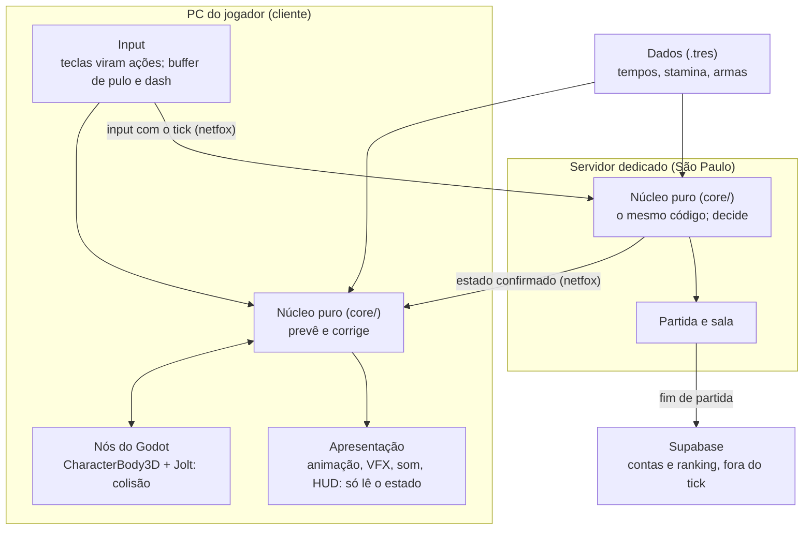

# Visão geral

Estado atual: o que as DECs aceitas em 02/10/2026 já fixam. O Desenho 2 (TASK-4) detalha a forma do estado, as cenas e os autoloads.

## As camadas



O mesmo núcleo roda dos dois lados: no cliente ele prevê, e no servidor ele decide (DEC-0003, DEC-0004). Entre o núcleo e a tela ficam os nós do Godot, que fazem a colisão. O núcleo decide a intenção, o nó move e consulta a física, e devolve fatos como "está no chão" (F-007 §2).

## Os contextos (DDD estratégico)

| Contexto | Onde roda | Tratamento |
|---|---|---|
| Simulação: combate e movimento | No servidor e, como previsão, no cliente, a cada tick | Domínio central: glossário e núcleo puro, sem aggregate nem repository |
| Partida e round | Servidor | Máquina de estados pequena e pura |
| Sala e lobby | Servidor, por RPC | Máquina de estados e CRUD |
| Progressão e estatísticas | Supabase | Aqui aggregate e o evento "partida terminou" fazem sentido |
| Contas | Supabase Auth | Pronto, sem modelar |

(F-007 §1)

Combate e movimento ficam no mesmo contexto porque dividem a stamina, o estado "no ar" e o tick. A fronteira que importa é Simulação (tick e rollback) contra Meta (request, response e banco). As duas se ligam pelo evento de fim de partida.

## As seis regras (DEC-0004)

1. Um único núcleo puro em `core/`, em ticks inteiros.
2. Os nós são adaptadores finos, e o efeito só toca em tick novo.
3. Os dados ficam em Resources imutáveis, referenciados por ID, com a conversão de ms para ticks testada.
4. Testar a regra, não a engine.
5. DDD só estratégico.
6. Crescer por marcos e medir a CPU com 16 bots antes de prometer o 8v8.

## O personagem (DEC-0004; F-007 §4)

O personagem é uma máquina de estados hierárquica, contada em ticks, feita com a `RewindableStateMachine` do netfox:

- **No chão:** parado, correndo, preparação, ativo, recuperação, parry, feint e troca de arma.
- **No ar:** pulo, parede, dash e gancho.

"Ninguém se defende no ar" é uma regra do superestado. Nada de `Timer` nem `await`: cooldown é uma contagem de ticks dentro do estado. A animação só lê o estado.

## As pastas (DEC-0005)

```
core/       regras puras, sem nó
common/     código compartilhado
data/       Resources (.tres) de design
assets/     arte e áudio, no LFS, com CREDITS.md
addons/     gdUnit4, e o netfox quando entrar
test/       testes do gdUnit4
tools/      portão e checagens
<feature>/  player/, arena/, net/, ui/: nascem com a primeira task que precisar
```

## O que o Desenho 2 decide

- A forma do estado da simulação e do input.
- Como o `step` do núcleo se encaixa no `_rollback_tick` do netfox.
- As cenas do lutador e da arena, e os autoloads.
- Se os acessos inseguros viram erro em `core/`.
- As pastas por feature dentro do jogo.
