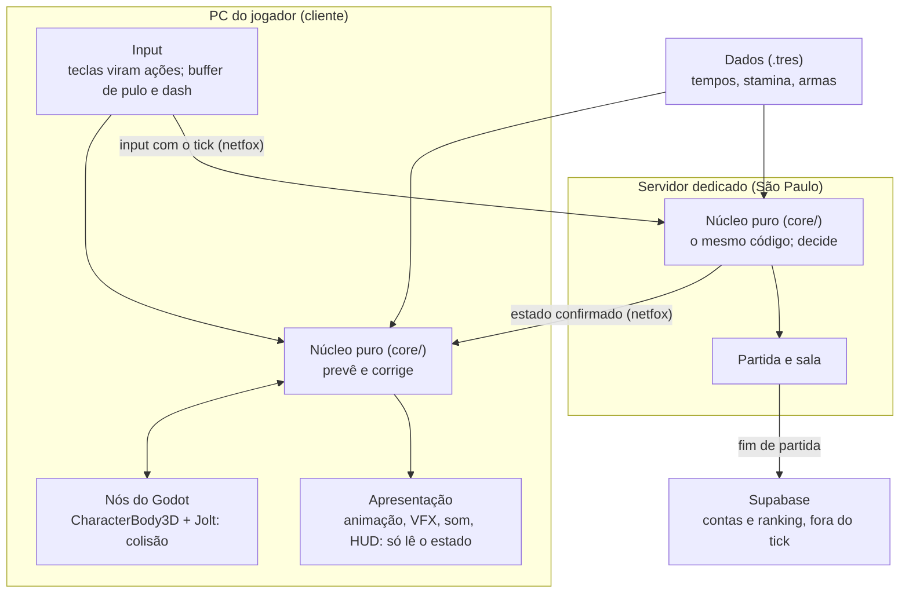
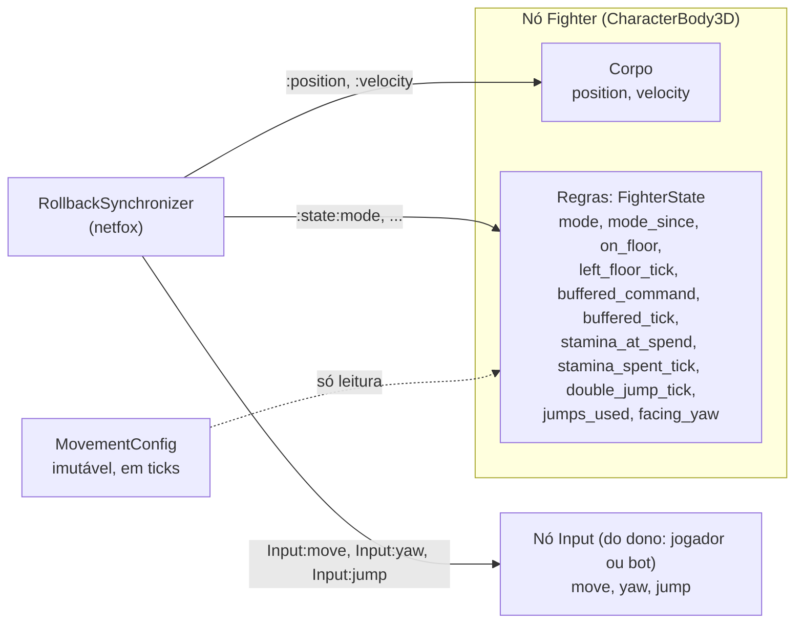
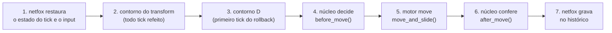
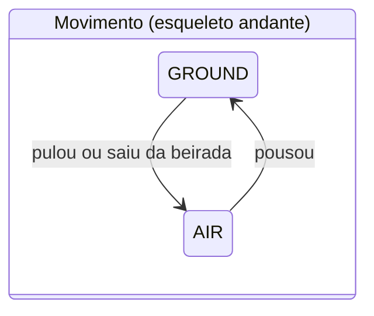
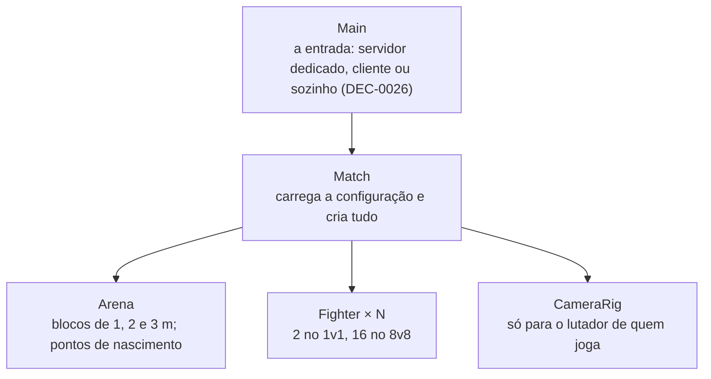

# Visão geral

Estado atual: as DECs aceitas até 19/10/2026. O Desenho 2 (TASK-4) está detalhado na DEC-0022, e o Desenho 3 (TASK-5) nas DEC-0023 a DEC-0026, com o detalhe da rede no [`rede.md`](rede.md). O esqueleto andante (TASK-9) existe desde a v0.1.0, e a fase 1 começa pela TASK-10.1, com a interface da fase combinada na DEC-0039. A versão visual e interativa deste documento é o artefato [O tick por dentro](https://claude.ai/artifact/EJCYbVj6oCZcim765nDH8B), privado (DEC-0019); a da rede é a vitrine [A rede por dentro](https://claude.ai/artifact/Sb4Q5e4M16UymdoaR9UAzp).

## As camadas



O mesmo núcleo roda dos dois lados: no cliente ele prevê, e no servidor ele decide (DEC-0003, DEC-0004). Entre o núcleo e a tela ficam os nós do Godot, que fazem a colisão.

## Os contextos (DDD estratégico)

| Contexto | Onde roda | Tratamento |
|---|---|---|
| Simulação: combate e movimento | No servidor e, como previsão, no cliente, a cada tick | Domínio central: glossário e núcleo puro, sem aggregate nem repository |
| Partida e round | Servidor | Máquina de estados pequena e pura |
| Sala e lobby | Servidor, por RPC | Máquina de estados e CRUD |
| Progressão e estatísticas | Supabase | Aqui aggregate e o evento "partida terminou" fazem sentido |
| Contas | Supabase Auth | Pronto, sem modelar |

(F-007 §1)

A fronteira que importa é Simulação (tick e rollback) contra Meta (request, response e banco). As duas se ligam pelo evento de fim de partida.

## As seis regras (DEC-0004)

1. Um único núcleo puro em `core/`, em ticks inteiros.
2. Os nós são adaptadores finos, e som e efeito tocam uma vez por evento, pela chave (DEC-0031).
3. Os dados ficam em Resources imutáveis, referenciados por ID, com a conversão de ms para ticks testada.
4. Testar a regra, não a engine.
5. DDD só estratégico.
6. Crescer por marcos e medir a CPU com 16 bots antes de prometer o 8v8.

Duas frases da DEC-0004 mudaram: a máquina de estados não usa mais a `RewindableStateMachine` do netfox (DEC-0022; veja abaixo), e som e efeito tocam pela chave do evento, não pelo tick novo (DEC-0031).

## O tick

Um tick é uma rodada de atualização do jogo. Em cada uma, o jogo lê o que cada lutador apertou, aplica as regras e anota a nova situação, sempre no mesmo ritmo. Quando dizem que o Valorant tem servidor de 128 ticks, é isso: 128 rodadas por segundo. No TypeScript, seria um `setInterval(atualizarJogo, 33)`.

- O jogo roda a 60 ticks por segundo, um a cada 16,7 ms (DEC-0024). O padrão do netfox é 30 (`netfox/time/tickrate` em `addons/netfox/netfox.gd`, commit `cf5189d`); o `project.godot` guarda o 60, e o teste de configurações vigia.
- O tick decide; o frame só desenha. Um PC a 144 FPS e outro a 40 pulam igual, porque a regra roda no tick.
- O netfox guarda 64 ticks de histórico para o rollback, que dão 1,07 s a 60 por segundo, e roda até 8 ticks num frame quando precisa alcançar o relógio (`addons/netfox/netfox.gd`, commit `cf5189d`). A ordem do loop está no `rede.md`.

## O estado em quatro caixas (DEC-0022)

Tudo o que a regra lê ou escreve num tick precisa estar numa caixa que o netfox grava. O que ficar fora é estado escondido: o rollback volta no tempo e o esquece (F-007 §6).



| Caixa | Onde mora | O que guarda no esqueleto andante | Por que ali |
|---|---|---|---|
| Corpo | Nó `Fighter` | `position` (Vector3), `velocity` (Vector3, m/s) | O netfox restaura todos os corpos juntos antes de cada tick re-simulado, e um lutador colide com o outro na posição daquele tick |
| Regras | `FighterState`, um objeto só de valores | `mode`, `mode_since` (tick), `on_floor`, `left_floor_tick`, `buffered_command` e `buffered_tick` (a vaga do buffer, DEC-0039), `stamina_at_spend` e `stamina_spent_tick` (a stamina como valor mais carimbo), `double_jump_tick`, `jumps_used`, `facing_yaw` (rad) | O núcleo puro recebe e devolve esse tipo; o netfox grava campo a campo, por valor |
| Input | Nó `Input` (script `FighterInput`) | `move` (Vector2, relativo à câmera, até 1), `yaw` (rad), `jump` (um toque) | O bot preenche as mesmas três coisas; a regra não sabe quem aperta (DEC-0004) |
| Configuração | `MovementConfig`, fora do estado | Os números do `movimento.md` em ticks e a física derivada para o tick | Nunca muda na partida, então não precisa voltar no tempo |

- **Fase 1, combinado no plano da TASK-10 (F-100):** a vaga do buffer, a stamina como valor mais carimbo e o `double_jump_tick` (TASK-10.1); `dash_tick` e `dash_direction` com o modo DASH (TASK-10.4); `wall_normal`, `wall_id` (o caminho do colisor relativo à arena, nunca um id do motor) e `wall_jump_tick` com o modo WALL_RUN (TASK-10.5); `grapple_fired_tick`, `grapple_point` e `grapple_end_tick` com o modo GRAPPLE (TASK-10.6); `slide_off_dir` (TASK-10.7). No input, `dash`, `grapple` e `pitch`. Os carimbos de fim substituem os `*_ready_tick` do esboço antigo: a recarga conta do fim da manobra.
- **Fase 2, só o nome:** `action`, `action_since` e o golpe por ID, nunca o Resource (F-007 §5).

## O tick por dentro: o sanduíche (DEC-0022; contornos da DEC-0025)



Os dois contornos são código do nó, porque tocam o motor, e foram provados pela SyncTest do Desenho 3 (F-025; DEC-0025):

- **O contorno do transform** empurra a posição restaurada de cada lutador para a física (estático, transform, cinemático). Sem ele, o Jolt colide com o outro lutador onde ele estava no presente.
- **O contorno D** alinha o "estava no chão" que o `move_and_slide()` guarda sozinho, com um micro-movimento de sonda no primeiro tick de cada rollback. Sem ele, o pouso e a rampa saem diferentes ao refazer.

```
before_move(state, position, velocity, input, config, tick) -> MovePlan    # puro: decide (a posição desde a DEC-0039)
move_and_slide()                                                  # motor: move e colide
after_move(state, facts, config, tick) -> FighterState            # puro: confere
```

- `before_move` carimba o input, aplica buffer, coyote, pulo, aceleração e gravidade, e devolve o estado novo e a velocidade pedida.
- O nó multiplica a velocidade pelo `physics_factor`, move e divide de volta (`docs/netfox/tutorials/rollback-caveats.md`, commit `cf5189d`).
- `after_move` recebe os fatos do movimento (`MoveFacts`): se terminou no chão, a velocidade depois da colisão e, na fase 1, a parede. Com eles, atualiza o modo, o `on_floor`, o carimbo de saída do chão e os pulos usados.
- As duas fatias de pão são funções puras em `core/`, testadas com tabela, sem cena. O recheio é a única linha que toca a física do Godot.

## A máquina de estados (DEC-0022)

O lutador está sempre num modo. O modo é um dado no estado (`mode` e `mode_since`), e a troca é uma função pura.



- **Fase 1:** WALL_RUN, DASH e GRAPPLE entram no mesmo campo.
- **Hierarquia como função:** `is_grounded(mode)` e `is_airborne(mode)`.
- **Combate em paralelo (fase 2):** um segundo modo, `action`, com NONE, WINDUP, ACTIVE, RECOVERY, BLOCK e PARRY. Correr enquanto golpeia não multiplica estados. "No ar ninguém se defende" vira uma regra entre os dois modos, e é ali que a matriz de posição da Q-14 vai morar.
- **Animação e efeito:** trocam no `NetworkTime.after_tick_loop`, comparando o modo desenhado com o do estado. Assim nunca tocam duas vezes num rollback. É o mesmo sinal que a `RewindableStateMachine` usa por dentro (`addons/netfox/network-time.gd`; `addons/netfox.extras/state-machine/rewindable-state-machine.gd`, commit `cf5189d`). Não existe barramento de eventos (F-007 §8).
- **Por que não a `RewindableStateMachine`:** ela é plana, grava só o nome do estado e põe a regra num nó por estado (`addons/netfox.extras/state-machine/rewindable-state-machine.gd`, commit `cf5189d`). A regra presa em nó também não acompanharia o núcleo se ele mudasse de linguagem (DEC-0020).

## O tempo e a física no estado (DEC-0022)

- **Carimbo, não contagem:** o estado guarda o tick em que algo aconteceu (`buffered_tick = 1040`), como o "flash 12:30" no chat do LoL. A regra calcula `tick - buffered_tick <= buffer_ticks` (a janela é inclusiva, DEC-0039). O netfox só manda o que mudou, porque o diff de estado vem ligado (`netfox/rollback/enable_diff_states` em `addons/netfox/netfox.gd`, commit `cf5189d`), e o carimbo muda uma vez.
- **Ms para tick:** o tick mais próximo, e o empate sobe. Um teste falha se o erro passar de meio tick.

| Tempo do design | A 30 ticks | A 60 ticks |
|---|---|---|
| Coyote, 100 ms | 3 ticks (100 ms) | 6 ticks (100 ms) |
| Buffer, 150 ms | 5 ticks (167 ms, +11 %) | 9 ticks (150 ms) |
| Janela de parry, 80 ms (leitura do v0) | 2 ticks (67 ms, −17 %) | 5 ticks (83 ms, +4 %) |
| Esquiva invulnerável, 250 ms | 8 ticks (267 ms, +7 %) | 15 ticks (250 ms) |

- **Física derivada para o tick:** a configuração calcula velocidade e gravidade já sabendo o tamanho do tick. Com a fórmula contínua, o pulo de 1,2 m chegaria a 1,09 m a 30 ticks e a 1,14 m a 60. Um teste garante 1,2 m, com tolerância de 1 cm, nas duas taxas.
- **A configuração nasce na carga:** o `Match` carrega o `.tres`, em ms e metros, e cria o `MovementConfig` uma vez, com o tickrate como parâmetro (F-018 §1). O núcleo nunca carrega arquivo.

## As cenas (DEC-0022; aprovadas no plano, F-022)

```
Fighter                    o lutador (CharacterBody3D, script fino)
├── Collision              a cápsula de 1,8 m × 0,35 m
├── Input                  o input do dono (FighterInput)
├── RollbackSynchronizer   do netfox: grava as caixas a cada tick
├── TickInterpolator       do netfox: suaviza o desenho entre ticks
└── Visual                 o boneco; só lê o estado
```



Os caminhos do netfox, como `Input:jump` e `:state:mode`, seguem a árvore de cena, como as rotas de uma API. Mudar a árvore depois quebra todas as rotas juntas; por isso a árvore se decide agora.

## Os autoloads (DEC-0022)

Nenhum nosso; só os 14 que o netfox traz, como o `NetworkTime` (`AUTOLOADS` em `addons/netfox/netfox.gd` e em `addons/netfox.extras/netfox-extras.gd`, commit `cf5189d`). Eles ficam listados à mão no `project.godot`, com caminho `res://`, porque o plugin os registraria com `uid://` e quebraria o primeiro import (#659). O teste de configurações guarda o mapa exato, e falha também se aparecer um autoload nosso (DEC-0023). Uma variável global fica fora das caixas e não volta no tempo no rollback. A configuração é passada à mão, como prop drilling no React. Um autoload futuro, como as preferências do jogador, só entra com DEC própria e se nunca for lido dentro do tick.

## As pastas (DEC-0005; nomes da DEC-0022, aprovados no plano, F-022)

```
core/fighter/   estado, input do tick, fatos, regras e a configuração do lutador
core/time/      ms para tick
common/         código compartilhado
data/           os .tres e as classes deles (movement_data.gd e movement_v0.tres)
assets/         arte e áudio, no LFS, com CREDITS.md
addons/         gdUnit4 e o netfox (core, extras e internals; DEC-0023)
fighter/        a cena do lutador, o FighterInput, o CameraRig e o bot de teste
arena/          a arena e os blocos
match/          a partida
main/           a Main, os argumentos, o arquivo de parada e a medição de fps
net/            o aperto de mão, a sala e o gravador da corrida de 30 s
ui/             os textos da tela, por chave de tradução
test/           espelha o código: test/core/fighter/...; a referência em test/reference/
tools/          o portão, as checagens e os scripts de rede, de build e de release
```

Na raiz, o `Dockerfile` é a receita da imagem do servidor (DEC-0032 §1; `rede.md` §10).

O **jogador** é a pessoa; o **lutador** é o boneco, que também pode ser de um bot. É a diferença entre o invocador e o campeão no LoL.

## A tipagem (DEC-0005, DEC-0022)

- Declaração sem tipo e acesso inseguro são erro no projeto todo. É o `strict` do TypeScript. Os addons ficam de fora pelo `directory_rules`.
- **O furo do portão fechou:** antes, ele só pegava esses erros num script que algum teste carregasse. Desde a TASK-6, o passo "compilar tudo" carrega todos os nossos scripts numa execução só do Godot, em uns 4 s (F-049 §5), e os canários provam a cada rodada que ele ainda barra (F-039; DEC-0027).

## O que o Desenho 3 provou (TASK-5)

O Desenho 2 leu o netfox no código-fonte, na `main`, commit `cf5189d` (26/09/2026), sem instalar. O Desenho 3 o rodou no 4.7.2 e o pôs em `addons/` (DEC-0023).

| O que se apoia no netfox | Arquivo que confirma (commit `cf5189d`) | Situação |
|---|---|---|
| Cada propriedade é gravada por valor: lê com `get_indexed`, restaura com `set_indexed` | `addons/netfox/servers/data/snapshot.gd` | Confirmado no código |
| O caminho `:state:mode` lê o campo de dentro do objeto `state` | `addons/netfox/servers/data/property-pool.gd`; `addons/netfox/properties/property-entry.gd` | Confirmado no código |
| O estado é restaurado antes de cada tick re-simulado e gravado depois | `addons/netfox/rollback/rollback-synchronizer.gd` | Confirmado no código |
| `_rollback_tick(delta, tick, is_fresh)`, na ordem da árvore de cena | `addons/netfox/servers/rollback-simulation-server.gd` | Confirmado no código |
| O input é capturado uma vez por loop de ticks; o toque vale um tick | `docs/netfox/tutorials/input-gathering-tips-and-tricks.md` | Confirmado na documentação |
| A `RewindableStateMachine` é plana e grava só o nome | `addons/netfox.extras/state-machine/rewindable-state-machine.gd` | Confirmado no código |

**As três hipóteses do Desenho 2, testadas com o netfox rodando no 4.7.2.** O método, os números e o que sobrou estão no `rede.md` §4.

| Hipótese | Resultado |
|---|---|
| 1. O caminho aninhado `:state:mode` grava, restaura e vai pela rede | **Provada:** 0 divergências na SyncTest com os campos envenenados, e 349 de 349 pulos pela rede (F-025 §2; F-026 §3) |
| 2. O contorno do transform deixa um lutador colidir com o outro na posição certa ao refazer | **Provada, com o contorno:** de 786 para 6 divergências a 30 ticks, e de 1.897 para 32 a 60. As que sobram são de um lutador em pé na cabeça do outro (F-025 §3; Q-16) |
| 3. Guardar `on_floor` no estado substitui o movimento extra de velocidade zero | **Derrubada:** o `move_and_slide()` guarda o próprio "estava no chão". O contorno D zera as divergências e substitui essa hipótese (F-025 §4; DEC-0025) |
